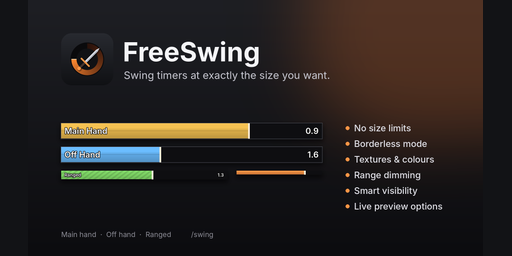
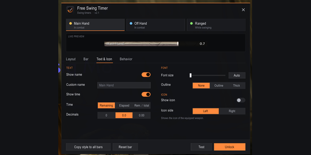
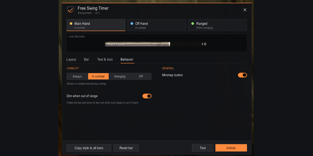

<h1 align="center">Free Swing</h1>

Swing timers for main hand, off hand and ranged, at exactly the size and style you want.

<a href="https://www.curseforge.com/wow/addons/freeswing"><b>Download on CurseForge</b></a> · version <b>2.5.1</b> · WoW Forever (1.60.1) · <code>/swing</code>

## Screenshots

<table>
<tr>
<td width="50%" valign="top"> <b>Text &amp; icon</b> Name, time, decimals, icon, font and outline for each bar.</td>
<td width="50%" valign="top"> <b>Behavior</b> Show always, in combat, only while swinging, or never; dim when out of range.</td>
</tr>
</table>

Main hand, off hand and ranged swing timers for WoW Forever.

## Features

- Three bars (main hand, off hand, ranged), each with its own size (no limit), scale, texture, colours, border and background.
- Texts: name and time (remaining, elapsed or both, with decimals), **font with a live preview**, size and outline; optional weapon icon on either side.
- Visibility: always, in combat, only while swinging, or hidden. Dims when your target is out of range.
- Live preview in the options, test mode, copy a bar's style to the others.
- **Unlock mode**: drag the bars, snap to each other or to a grid.
- **Profiles**: every character gets its own profile automatically; copy another character's, export / import.

**Want more fonts?** Install [SharedMedia Additional Fonts](https://www.curseforge.com/wow/addons/shared-media-additional-fonts) (or any LibSharedMedia font pack): its fonts appear automatically in the font lists.

## Commands

- `/swing` — options
- `/swing unlock` / `/swing lock` — move the bars
- `/swing test` — simulate a swing on every bar
- `/swing minimap` — show / hide the minimap button
- `/swing reset [mh|oh|rg|all]` — reset one bar or all of them
- `/swing <bar> width|height|scale <n>` — set a size directly (bar = mh, oh, rg or all)

## Free Hub

Free Swing works on its own. With **Free Hub** installed, its options open inside the hub next to the other Free addons, and a single minimap button replaces theirs.

## Notes

- Built for WoW Forever, using the game's swing event (the combat log is reserved to the game's own interface on this client).
- Bug reports and ideas are welcome in the comments.

## The Free suite

Addons for WoW Forever that share the same look, profiles and a single minimap button through Free Hub.

| | Addon | |
|---|---|---|
|  | **[Free Hub](https://github.com/DecardCainSuite/FreeHub)** — All the Free addons in one window: options side by side, product pages with gallery, and a single minimap button. | [CurseForge](https://www.curseforge.com/wow/addons/free-hub) |
|  | **[Free Unit Frames](https://github.com/DecardCainSuite/FreeUnitFrames)** — Fully customisable unit frames for player, target, focus, party, raid and bosses, with an ElvUI-style preset in one click. | [CurseForge](https://www.curseforge.com/wow/addons/freeunitframes) |
|  | **[Free Bars](https://github.com/DecardCainSuite/FreeBars)** — Up to 9 action bars, laid out as a grid or an arc, with mouseover fade, paging and a clean flat look. | [CurseForge](https://www.curseforge.com/wow/addons/freebars) |
|  | **[Free Swing](https://github.com/DecardCainSuite/FreeSwing)** (this one) — Swing timers for main hand, off hand and ranged, at exactly the size and style you want. | [CurseForge](https://www.curseforge.com/wow/addons/freeswing) |
|  | **[Free Minimap](https://github.com/DecardCainSuite/FreeMinimap)** — A rectangular minimap of any size, with a region map drawn from the game's own terrain tiles around you. | [CurseForge](https://www.curseforge.com/wow/addons/freeminimap) |
|  | **[Free Guild](https://github.com/DecardCainSuite/FreeGuild)** — Guild roster and rank tool for guild masters and officers: filters, bulk ranks, rules that promote for you, guild info and notes. | [CurseForge](https://www.curseforge.com/wow/addons/freeguild) |
|  | **[Free LFG](https://github.com/DecardCainSuite/FreeLFG)** — The group finder as a compact, sortable table: leader, roles, free slots, one-click whisper from a template, and live filters you write yourself. | [CurseForge](https://www.curseforge.com/wow/addons/freelfg) |

## Changelog

What is new in the current version: [CHANGELOG.md](CHANGELOG.md). Full history: [CHANGELOG-history.md](CHANGELOG-history.md).

## Repository layout and releases

- The repository root is the addon folder (`FreeSwing/`), as installed in `Interface\AddOns`.
- `curseforge/` holds the CurseForge page: `description.md` (fields, gallery captions, description) and `images/` (logo, gallery, social preview). It is not shipped in the addon zip.
- `CHANGELOG.md` holds the notes of the version being prepared; they are sent to CurseForge as the file's changelog.
- Releasing: bump `## Version` in `FreeSwing.toc`, write `CHANGELOG.md`, then publish a GitHub release named `v<version>`. GitHub Actions packages the addon with the [BigWigs packager](https://github.com/BigWigsMods/packager) and uploads it to CurseForge and to the GitHub release.

Bug reports and ideas are welcome in the issues or in the CurseForge comments.
